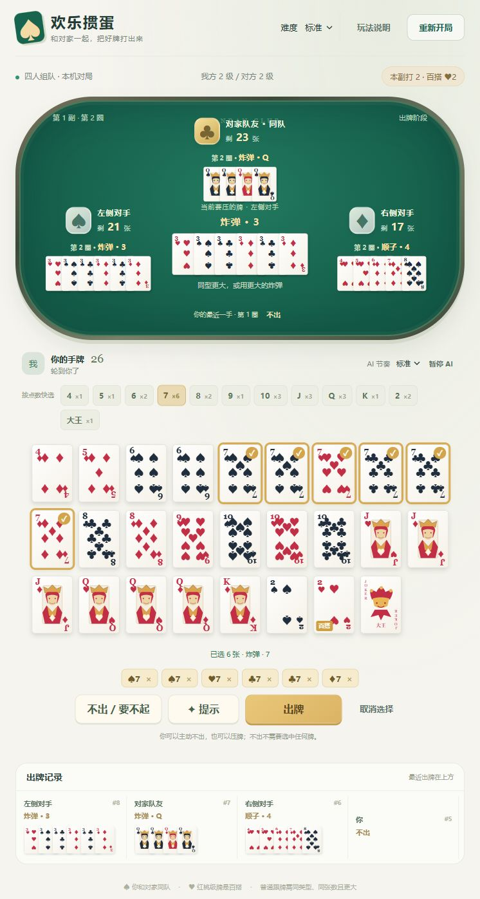
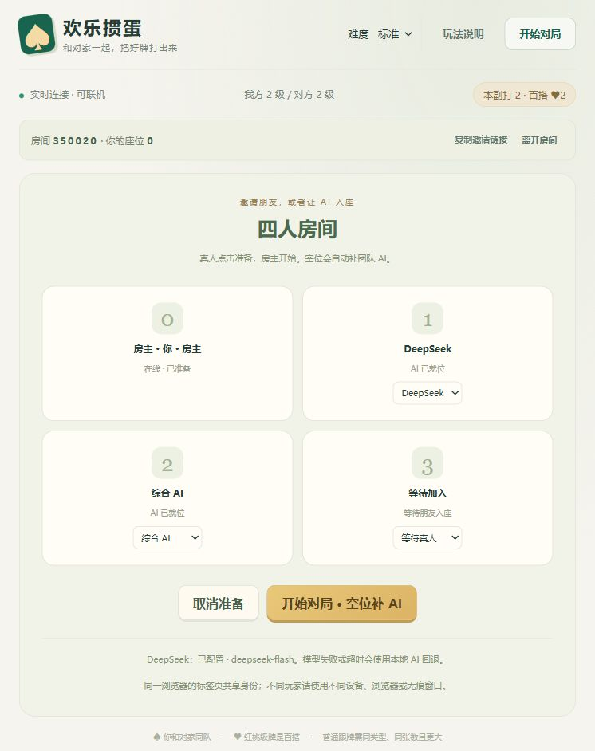
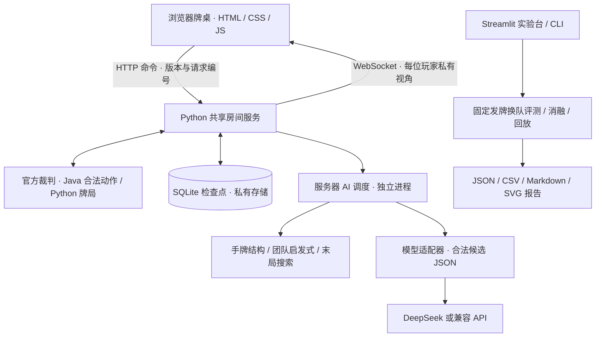
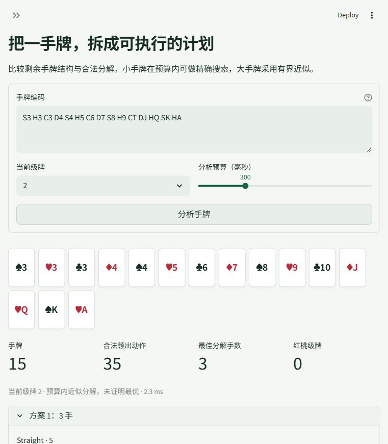
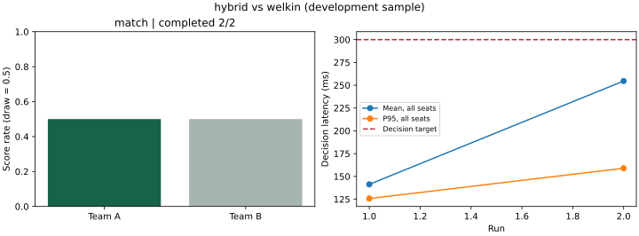
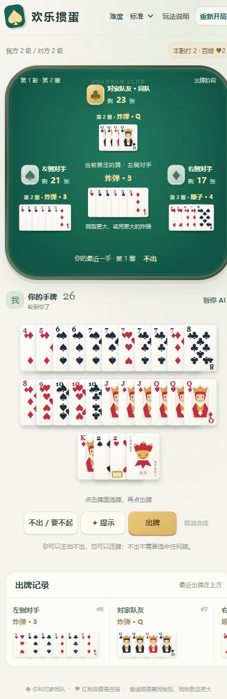

# 欢乐掼蛋与 AI 实验台

**可以和朋友一起玩的掼蛋牌桌，也可以用来研究、对比和评测掼蛋 AI。**




*实际浏览器截图：每张实体牌可独立选中，同点数可批量选择；对家在上方，两侧为对手。此截图用于展示选牌交互，联机配置见下方。*

基于 **OpenGuanDan 官方平台** 的 Python AI 项目。支持四人共享房间、真人与 AI 混合对局、可配置 DeepSeek 等兼容模型、私有 WebSocket 同步、服务器托管与 SQLite 恢复。另有手牌组牌、团队启发式、公开记牌、未知手牌抽样、末局搜索、固定发牌换队评测、开源算法对照、消融与日志回放。

核心策略不读取对手或队友的真实隐藏手牌。离线裁判保存的完整牌局数据只用于赛后复盘；在线出牌原样选择服务器 `actionList` 中的动作。

这不是已托管的在线游戏地址。克隆后在自己的电脑启动即可体验，朋友可通过同一局域网加入；公网部署另有 Docker 与 Nginx 模板。仓库不附带供应商密钥、私人牌局数据库或第三方平台运行时。

## 目录

- [快速开始](#快速开始)：安装、下载裁判与启动。
- [已实现功能](#已实现功能)：游戏、联机与研究能力。
- [亲自玩一局](#亲自玩一局)：选牌、提示、不出与完整比赛。
- [四人联机与 AI 入座](#四人联机与-ai-入座)：创建房间、邀请与托管。
- [配置 DeepSeek 对手](#配置-deepseek-对手)：本地密钥和合法候选决策。
- [架构与信息边界](#架构与信息边界)：前端、裁判、策略与恢复。
- [AI 实验台与结果示例](#ai-实验台与结果示例)：手牌分析、回放和公开验证。
- [策略名称与配置](#策略名称与配置)、[线上 PK](#线上-pk)、[测试与项目结构](#测试与项目结构)。

## 快速开始

需要 Python 3.11+、JDK 17+。Windows 推荐使用独立虚拟环境，无需修改 PowerShell 执行策略：

```powershell
git clone https://github.com/xushuodawawang/guandan-ai-lab.git
cd guandan-ai-lab
python -m venv .venv
.\.venv\Scripts\python.exe -m pip install -e ".[dev]"
.\.venv\Scripts\python.exe -m guandan_ai fetch-platform --server
.\.venv\Scripts\python.exe -m guandan_ai fetch-baseline
.\.venv\Scripts\python.exe -m guandan_ai doctor
.\.venv\Scripts\python.exe -m guandan_ai ui
```

如果当前环境已有所需库，也可在项目目录直接使用 `python -m guandan_ai ...`。分析实验台默认在 <http://127.0.0.1:8501>，默认页自动启动并嵌入网页牌桌 <http://127.0.0.1:8502>。Linux/macOS 将上述 Python 路径改为 `.venv/bin/python`。

`fetch-platform` 和 `fetch-baseline` 按固定 commit 下载并校验 Git blob 哈希，文件保存在 `.runtime/`，没有重新发布官方二进制或第三方源码。下载需要网络；可重复执行修复文件。网络或沙箱拒绝本机套接字时，请在普通本机终端运行客户端和 UI。

只想玩牌、不需要分析实验台时：

```powershell
.\.venv\Scripts\python.exe -m guandan_ai play --port 8502
```

打开 <http://127.0.0.1:8502/>，点击 **快速单人对局**。运行牌桌需要官方运行时，但不需要下载 `welkin` 对照算法，也不需要 API 密钥。本地 AI 可独立完成对局。

| 入口 | 默认地址 | 用途 |
|---|---|---|
| 欢乐掼蛋牌桌 | `http://127.0.0.1:8502/` | 单人、共享房间、真人与 AI 混合对局 |
| 房间实时通道 | `ws://127.0.0.1:8503` | 浏览器自动连接，无需手动访问 |
| Streamlit 实验台 | `http://127.0.0.1:8501/` | 手牌分析、记牌预测、回放与后台 PK |
| 课程官方服务器 | HTTP `3000` / WebSocket `8181` | 独立的官方客户端比赛入口 |

Java 自动检测优先使用 `JAVA_HOME` 和 Windows JDK 目录。需要指定 Java 时：

```powershell
$env:GUANDAN_JAVA = 'C:\Program Files\Java\jdk-23\bin\java.exe'
python -m guandan_ai doctor
```

## 已实现功能

| 模块 | 实现 |
|---|---|
| 欢乐掼蛋 | 四人共享房间、真人/本地 AI/模型 AI 混合座位、选牌、不出、提示、托管、升级与进贡还贡、日志导出 |
| 联机与恢复 | 房间码、入座准备、私有 WebSocket、服务器推进、超时托管、重连、SQLite 检查点恢复 |
| 大模型对手 | 通用 Chat Completions JSON 适配、合法候选选择、独立进程、异常回退、token/耗时/计价统计 |
| 平台客户端 | 创建/加入房间、阶段路由、出牌/进贡/还贡、结果解析、断线报错、日志 |
| 手牌分析 | 两副牌多重计数、级牌、官方合法组牌、多个分解；小手牌预算内精确搜索，大手牌近似 |
| 团队策略 | 剩余结构、拆牌代价、控制牌资源、队友让牌、对手将走完的压力 |
| 记牌预测 | 已出牌、交接归属、未知牌守恒约束、PASS 软权重、可行分配抽样 |
| 末局搜索 | 团队 alpha-beta、迭代加深、置换缓存、候选裁剪、多分配根动作聚合 |
| 时间控制 | 搜索软预算；在线独立进程隔离，超过预算加 IPC 等待后终止并合法回退 |
| 评测 | 固定牌堆换队、完整比赛/单小局区分、可选进程硬预算、配对 bootstrap、异常统计 |
| 已有算法对照 | 已适配 MIT 开源 `welkin03/guandan-ai` 的 `heuristic_policy` |
| 界面 | 手牌分析、对局回放、记牌预测、后台运行 PK、统计、JSON/Markdown/SVG 下载 |

## 亲自玩一局

打开实验台，左侧选择 **欢乐掼蛋**（默认页），可点击 **全屏打开牌桌**。选择难度，再点 **快速单人对局**；也可创建房间，邀请朋友或单独设置每个 AI 座位。你的对家始终显示在上方。直接启动：`python -m guandan_ai play --port 8502`，访问 <http://127.0.0.1:8502>。

- 牌面使用原创 SVG，包含角标、点数花色、人物牌和大小王。手牌网格不重叠，整张牌可点击，选中显示金色边框和勾选；上方点数按钮可批量选同点数牌，下方已选清单可逐张移除。点击 **出牌** 提交，空选牌或非法组合只显示提示，不会中断牌局。
- 跟牌时可直接点击 **不出 / 要不起**，无需选牌，也不受已选牌影响。领出和交接阶段不能不出，会说明原因。
- **提示** 只选中建议的牌，不会替你提交。同一组百搭牌有多种合法解释时，可以选择具体牌型。
- AI 默认间隔约 1.4 秒，可切换慢速或快速；到你的回合等待。**暂停 AI** 可以改成逐步观察；你先出完时仍会继续播放其余玩家。
- 各家最近出牌跨圈保留，中央单独显示当前要压的牌，出牌记录持续可见。点击桌面或记录中的牌可放大查看。
- 每副结束后查看名次、升级结果，点击 **下一副** 继续从 2 到过 A 的完整比赛。进贡、还贡仍由你选牌确认，抗贡由官方引擎判断。
- **重新开局** 会替换当前牌局，使用新随机发牌和上方所选难度；切换实验台页面会保留牌局。
- 赛后点击 **保存复盘日志**，可在 **对局回放** 页导入。进行中的牌局不提供含隐藏手牌的日志下载。

牌桌前端为原生 HTML/CSS/JavaScript，无 npm 或 CDN 依赖；Python 提供官方裁判和共享房间。浏览器 Cookie 绑定玩家座位，SQLite 保存牌局检查点，重连和服务器重启可恢复。重复命令和过期回合会被拒绝。AI 由服务器独立推进，不依赖浏览器。

局域网启动：`python -m guandan_ai play --host 0.0.0.0 --port 8502 --ws-port 8503`。朋友用服务器局域网 IP 打开网页，以房间码加入。每个玩家需要独立浏览器身份。服务器模型密钥通过环境变量配置，不发送给前端。

使用方法和 DeepSeek 配置见 [联机使用与模型配置](docs/联机使用与模型配置.md)，设计依据见 [联机与大模型对手方案](docs/联机与大模型对手方案.md)。公网部署模板已准备，但没有实际发布。

## 四人联机与 AI 入座



*截图中的六位房间码来自本机演示，不是公共服务器的可用房间。DeepSeek 已配置状态表示演示服务器有密钥；新安装需要自行配置。*

```powershell
python -m guandan_ai play --host 0.0.0.0 --port 8502 --ws-port 8503 --store data/server/rooms.sqlite3
```

1. 房主输入昵称并创建房间，分享房间码或邀请链接。
2. 朋友访问 **服务器电脑的局域网 IP**，例如 `http://192.168.1.10:8502/`；这里的地址仅为示例。其他设备不能用 `127.0.0.1` 访问房主电脑。
3. 真人选择空位并准备。实际座位 **0 / 2 同队，1 / 3 同队**；每个人的牌桌都会旋转成本人在下方。
4. 房主可以把空座位设置为休闲、团队、综合或已配置的模型 AI。开始时仍空着的座位自动补团队 AI。
5. 真人默认每回合 90 秒，超时后自动托管，可随时取消托管。单人房间可暂停或单步，多人房间持续推进。

同一浏览器标签页共享身份，四名玩家请使用不同设备、浏览器或独立无痕会话。刷新和短暂断线后会恢复座位；服务器重启后从 SQLite 重放动作轨迹恢复牌局。清除 Cookie 后无法仅凭相同昵称领取旧座位。

## 配置 DeepSeek 对手

没有密钥时可正常使用所有本地 AI；模型选项显示未配置，服务器不会自动调用供应商。

```powershell
Copy-Item .env.example .env
```

在本机编辑 `.env`，填写自己的 `DEEPSEEK_API_KEY`。这个文件已被 Git 和 Docker 构建忽略，不要把真实密钥填进 README、截图、前端 JavaScript 或配置示例。

```dotenv
# 模板字段说明；API_KEY 的值请只填写在本地 .env 中。
DEEPSEEK_API_KEY=
DEEPSEEK_MODEL=deepseek-flash
DEEPSEEK_TIMEOUT=12
DEEPSEEK_THINKING=disabled
```

重启牌桌后，将一个空座位改成 **DeepSeek**，再开始对局。模型名称需与自己的账户支持列表一致；服务器默认关闭思考模式，让请求在有限回合时间内返回简短 JSON。[供应商思考模式文档](https://api-docs.deepseek.com/guides/thinking_mode/)

模型调用过程：官方引擎给出合法动作 → 本地策略排序与裁剪候选 → 发送该玩家自己的手牌及公开信息 → 模型返回 `{"candidate_id": 7}` → 检查编号、回合版本并执行原始合法动作。候选保留 PASS、可直接出完的动作和必要控制牌，默认最多 24 个。

接口异常、超时、空内容、截断或非法编号会回退到本地合法策略。页面可以查看模型动作数、回退数、token 用量和耗时；没有配置单价时，费用显示未知。实际模型对局会产生供应商费用。

其他兼容 Chat Completions 接口可通过 [配置示例](configs/llm.example.json) 注册，密钥字段只接受环境变量名。详细字段、预算和模型 PK 命令见 [配置文档](docs/联机使用与模型配置.md)。

## 架构与信息边界



| 数据 | 使用位置 | 对外边界 |
|---|---|---|
| 自己的手牌、公开出牌、剩余张数 | 玩家视角与策略观测 | 每位玩家只收到自己的隐藏手牌 |
| 官方全部手牌与发牌种子 | 裁判、私有恢复检查点 | 不进入活跃牌局公开状态或模型请求 |
| API 密钥 | 服务端环境变量 / 本地 `.env` | 不进入 Cookie、浏览器快照、复盘或 Git |
| 完整赛后复盘 | 已结束小局的复盘工具 | 进行中的牌局不提供完整手牌下载 |

房间锁保护回合状态，远程请求在锁外执行；任务携带回合版本，玩家接回托管或重开后，迟到结果会被丢弃。命令编号用于重试去重，过期版本被拒绝。浏览器负责选牌与显示，AI 推进由服务器负责。

## AI 实验台与结果示例



实验台用于把算法过程看清楚：输入手牌，比较分解方案；导入复盘，逐步查看出牌；观察公开记牌与未知手牌抽样；选择策略，在后台运行 PK 后查看生成报告。

| 本机开发验证 | 实际结果 | 解释 |
|---|---|---|
| 自动回归 | 73 项通过 | 包括规则、AI、WebSocket、隐私、恢复与模型异常处理 |
| `hybrid` 对 `welkin` 适配版 | 1 个换队配对，2 场完整比赛，一胜一负 | 样本不足以推断稳定胜率；软预算超时如实记录 |
| 官方服务器四 AI 比赛 | 9 个小局、703 次决策，0 异常回退 | 一次线上完整比赛，未控制发牌，不能当作同牌配对 |
| DeepSeek 真实接口 | 1 次合法掼蛋决策，无回退，1,201 tokens | 证明接口与候选选择链路可用，未完成棋力评测 |



图表来自真实开发评测，不是示意数据。公开的 [已有 AI 对照报告](reports/examples/existing-ai/report.md) 与 [官方线上报告](reports/examples/online/report.md) 保留样本、预算、耗时和限制；[验证记录](reports/verification.md) 记录具体测试范围。公开仓库仅附带选定汇总报告与生成的演示回放，不附带本机私人牌局数据库。

<details>
<summary>查看手机布局截图</summary>



手机布局截图用于展示响应式排列；牌型和动作仍由同一官方裁判验证。

</details>

## 策略名称与配置

- `hybrid`：手牌结构 + 团队决策 + 末局抽样搜索。
- `team`：手牌结构与团队启发式，不使用末局搜索。
- `greedy` / `random`：开发用弱基线。
- `welkin`：已发布开源启发式算法适配，需要先 `fetch-baseline`。
- `no-structure` / `no-belief` / `no-search`：分别关闭结构评分、PASS 行为权重、末局搜索。
- `plugin:模块名:工厂名`：接入教师、同学或其他已有算法。
- `llm:deepseek`：配置密钥后的远程模型策略，同样只选择合法候选。

`configs/default.json` 提供结构、抽样数、搜索触发张数、深度及节点预算。使用 `--config configs/default.json`；字段必须匹配 `PolicyConfig`。`--budget` 的单位为毫秒。

```powershell
python -m guandan_ai analyze S3 H3 C4 D5 S6 H7 --trump 2
python -m guandan_ai evaluate --a hybrid --b greedy --pairs 4 --mode episode --output data/runs/development
python -m guandan_ai evaluate --a hybrid --b welkin --pairs 10 --mode match --strict-budget --budget 500 --output data/runs/formal
python -m guandan_ai ablate --b welkin --pairs 4 --mode match --strict-budget --budget 500 --output data/runs/ablation
```

每个配对使用相同起始发牌和首家，再交换 A/B 队伍。`episode` 只统计一个小局；`match` 跑官方离线环境直到完整比赛结算，覆盖升级、抗贡、进贡和还贡。输出为 `summary.json`、`matches.csv`、逐场 JSONL、`report.md` 和 `report.svg`。

默认离线预算是**软目标**，真实超预算次数会报告。正式公平对照建议开启 `--strict-budget`，双方均使用可终止的进程。在线一律隔离策略；预算外留 80ms IPC 等待，终止清理也计入实际耗时。比赛组织方的限制应按其实际规则配置。

单个配对无法形成可靠棋力结论；置信区间按配对组计算。完整比赛中的多个小局不被当成相互独立的比赛。失败、未完成和回退不会隐藏。

## 线上 PK

先在一个终端运行官方服务器，再在另一个终端连接：

```powershell
python -m guandan_ai server
```

```powershell
python -m guandan_ai arena --strategies hybrid greedy hybrid greedy --budget 200 --output data/runs/online
```

`arena` 按座位顺序入房，兼容原生平台按到达顺序分配座位的行为。不能把 `JOIN_ROOM.data.userNum` 一律当座位；客户端以 `beginning.myPos` 校验。官方服务器默认 WebSocket 8181、HTTP 3000；`--url` 可以连接课程指定服务器。

`arena` 和单个 `client` 结束后也生成 JSON、CSV、Markdown 和 SVG 报告。线上结果不标记为同牌配对；单客户端耗时只涵盖本人，未知对手名称记为 `external`。`--rounds` 大于 1 时只报告最终平台会话结果，不猜测未广播的中间比赛胜负。

与同学 PK 时只运行自己的客户端。例如已经存在房间 12，需要加入座位 2：

```powershell
python -m guandan_ai client --url ws://127.0.0.1:8181 --room 12 --seat 2 --strategy hybrid --budget 200
```

创建房间时不传 `--room`，客户端会打印房间号。0/2、1/3 分别组队。实际座位不一致时会报错，避免用错队友视角。平台没有公开可靠的重新连接/恢复协议，因此断线会退出，不擅自把新连接当成原比赛。

## 接入教师或同学算法

工厂接收 `seat, seed, rules, config`，返回提供下列方法的对象：

```python
def observe(self, event: dict):
    # 可选：接收当前玩家的可见事件。
    ...

def decide(self, observation, budget_ms=200):
    # observation.actions 是完整平台合法动作列表。
    # 返回 Decision(index=原列表中的索引, reason=选择理由)。
    ...
```

实际可运行的插件契约示例是 `examples.external_policy.FirstLegalPolicy`：

```powershell
python -m guandan_ai evaluate --a hybrid --b plugin:examples.external_policy:FirstLegalPolicy --pairs 1
```

该示例仅验证接入，不冒充已有强 AI。教师与同学的实际程序没有随题目提供；插件接好后再完成真实同学 PK，不能用本项目自身基线替代这一课程要求。

## 开源对照的边界

`welkin` 使用原项目发布的 `heuristic_policy`，不重写其评分规则。适配器将平台牌型、大小王、序列主点数及重复实体牌映射为上游类型，并提供平台合法动作。其他玩家的手牌使用 `CountOnlyHand`：只能读张数，尝试遍历牌值会报错。未调用上游额外的全信息 guard；上游不覆盖的进贡/还贡使用本项目交接策略。

这是该公开启发式算法的**平台适配版**，不是原作者完整训练/搜索栈或神经权重。其自身手牌估价可能比本项目慢，应结合耗时和回退率看结果。固定 commit 与许可证见 [THIRD_PARTY.md](THIRD_PARTY.md)。

## 测试与项目结构

```powershell
python -m pytest -q
python -m pytest -q -m "not integration"
```

集成测试需要已下载官方引擎；开源对照测试还需要 `fetch-baseline`。测试包括重复牌/配牌、公开记牌守恒、交接约束、策略合法性、接风/PASS 链与官方环境对照、完整比赛、进程超时及 Streamlit 交互。

```text
guandan_ai/
  cards.py, models.py          牌表示、观测和动作契约
  platform.py, rules.py        固定版本下载、官方 Java worker 与离线环境适配
  analysis.py, belief.py       合法手牌分解、记牌和抽样
  policies.py, search.py       团队启发式、末局搜索和消融
  existing_ai.py               已发布开源算法的公开信息适配
  client.py, worker.py         WebSocket 客户端、在线进程隔离
  evaluation.py, logging.py    评测、报告、图表和原始日志
  replay.py, ui.py, cli.py     回放、Streamlit 与命令行
  game.py, multiplayer.py     真人牌局、共享房间、自动托管与调度
  web_server.py, room_store.py HTTP / WebSocket 服务、SQLite 恢复
  llm.py, local_config.py      模型候选适配、服务端私有配置
  web/, card_art.py           原生网页前端、原创 SVG 牌面
tests/, configs/, examples/, docs/, reports/
```

末局求解基于抽样、有限深度和候选裁剪，不能保证不完全信息最优。出牌阶段的搜索转移经过官方 Python 环境契约测试；线上与离线的结算/过 A 细节不应被假定完全一致，正式比赛以指定线上裁判为准。深度强化学习训练未纳入本版。

## 部署与课程交付

提供 [Dockerfile](Dockerfile)、[Compose](compose.yaml) 和 [Nginx HTTPS 模板](deploy/nginx.conf.example)。需要先启动 Docker 引擎，再运行 `docker compose up --build -d`。HTTP 与 WebSocket 分别使用 8502、8503，私有 SQLite 数据挂载到本机 `data/server/`。公网部署还需要自己的服务器、域名和证书，详情见 [部署说明](docs/联机使用与模型配置.md#docker-与公网)。本次仅验证 Compose 配置语法，没有声称完成容器运行或公网发布。

本项目覆盖课程要求中的 AI 实现、已有算法对照、比赛统计与报告。与同学的实际 PK 需要对方客户端或比赛房间；目前提供接入入口，不把本项目自带弱基线当作同学成绩。

## 许可证与来源

本仓库原创代码、文档和牌面按 [MIT License](LICENSE) 发布。第三方运行时、依赖和对照算法遵循其各自授权，不受本仓库 MIT 许可证替代。来源、固定版本及适配范围见 [THIRD_PARTY.md](THIRD_PARTY.md)。

感谢 [GameAI-NJUPT/OpenGuanDan](https://github.com/GameAI-NJUPT/OpenGuanDan) 提供课程比赛平台，以及 [welkin03/guandan-ai](https://github.com/welkin03/guandan-ai) 提供 MIT 启发式对照。官方平台未发现明确许可证，因此由用户启动下载流程获取，不随本仓库重新分发其原始源码或二进制。

