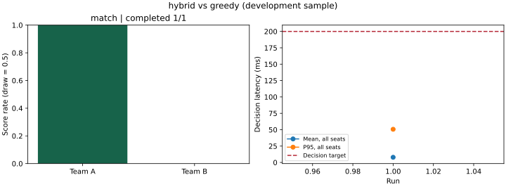

# 掼蛋 AI 评测报告

- 比较：`hybrid` 对 `greedy`
- 评测层级：完整比赛
- 官方环境版本：`online server; version not advertised`
- 决策预算：200.0 ms（进程隔离，预算 + 80ms IPC 等待后终止，清理时间额外记录）
- 已完成 / 总数：1 / 1，失败 0
- A 胜场：1，平局：0
- A 得分率（平局 0.5）：100.0%
- 完整配对组：0；95% 配对 bootstrap 区间：样本不足
- 异常回退：0；超软预算决策：0 / 703

## 逐场数据

| seed | 换队 | 状态 | A 得分 | 小局数 | 平均 ms | P95 ms |
|---|---|---|---|---|---|---|
| 1 | False | finished | 1.0 | 9 | 7.88 | 50.64 |

## 解释与限制

本结果来自线上服务器，未控制发牌或同牌配对。seed 是策略种子，不能当作服务器发牌种子。耗时只涵盖已记录客户端。
该结果只代表此版本、对手、样本与预算；小样本开发评测不构成棋力结论。官方离线环境与线上服务器仍须分别做规则契约验证。
末局搜索基于未知牌抽样、候选裁剪和有限深度，不能保证不完全信息下最优。同学策略未提供时，不能把内置弱基线当作已完成同学 PK。

## 图表

