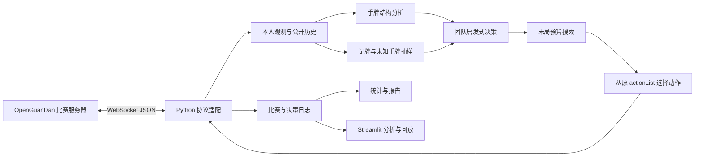

# 掼蛋 AI 课题方案与 GitHub 调研

调研日期：2026-10-12。当前阶段：需求理解、架构设计和资料筛选。

本文仅为方案，没有实现 AI、搭建前端、安装依赖或 skills，也没有运行平台及开源模型。仓库结论来自 README、文件树及关键源码的静态检查，不代表已复现其性能。以下模块、目录、阶段和验收数量均为建议，不能理解为已完成的结果。

## 1. 对课题要求的理解

课题需要交付一个能接入指定平台的掼蛋 AI，并通过实际比赛证明其效果。手牌分析、牌理、末局搜索、记牌预测是可分工的方向；题目没有明确要求每个方向都做到复杂模型级别。

| 题目要求 | 对应工作 | 最终证据 |
|---|---|---|
| 根据平台和示例设计 AI | 协议适配、规则对齐、合法动作决策、进贡与还贡处理 | 可运行的 Python 客户端、算法说明、完整比赛日志 |
| 与同课题选手 PK | 配置对手和队伍、轮换座位、按课程规定参赛 | 对手版本、比赛配置、原始比赛结果 |
| 与已有 AI PK | 接入教师示例或适配已发布算法 | 真实既有算法对照，不能仅用自己写的随机算法替代 |
| 统计结果、形成报告 | 指标定义、批量评测、消融比较、案例复盘 | 原始数据、统计图表、可复现报告 |

推荐项目方向：**以手牌结构和队友协作为核心的启发式 AI，逐步加入公开信息推断与末局抽样搜索**。深度强化学习列为后续扩展，首版不依赖 GPU 训练。

实施前需补齐：教师提供的 AI 示例代码、提交形式、单步时间限制、最终计分标准、合作规则、截止日期和团队人数。目前工作目录没有这些资料，不能声称已经检查教师示例。

## 2. 已核验的平台条件

- [OpenGuanDan 根文档](https://github.com/GameAI-NJUPT/OpenGuanDan/blob/main/README.md)：客户端通过 WebSocket 交换 JSON；默认连接地址为 `ws://127.0.0.1:8181`。服务器提供本人手牌、各席剩余张数、当前级牌和合法动作列表。0/2 和 1/3 分别组队。
- 出牌、进贡、还贡必须原样选取 `actionList` 中的元素，包括牌序；还贡响应还需保留请求中的 `tributePos` 和 `tribute`。因此 AI 的在线核心是评价并选择合法动作。
- [Python 桥接目录](https://github.com/GameAI-NJUPT/OpenGuanDan/tree/main/guandan-java) 中已有 Python 环境和 Java 动作引擎接口。Python 实现 AI 不等于平台和全部规则必须改成纯 Python；官方桥接需要 Java 运行时。
- [run_smoke.py](https://github.com/GameAI-NJUPT/OpenGuanDan/blob/main/guandan-java/run_smoke.py) 检查规则桥接并随机走子，不是训练完的强 AI 或完整比赛客户端。
- [Table 源码](https://github.com/GameAI-NJUPT/OpenGuanDan/blob/main/guandan-java/engine/table.py) 支持指定 108 张 `deck_data`、首家和可选回退，可作为离线固定牌局与搜索的候选环境。使用前仍需验证状态恢复是否完整。
- [Python Wire 源码](https://github.com/GameAI-NJUPT/OpenGuanDan/blob/main/guandan-java/engine/types.py) 的 `gameResult` 使用 `victoryNum/draws`，而根文档使用 `victory/victoryRank`。需要为两种入口分别解释并归一化，不能直接把某一数字都当成完整比赛胜负。
- 同组织的 [OpenGuanDan-Simulator](https://github.com/GameAI-NJUPT/OpenGuanDan-Simulator) 提供 Java 服务器和动作引擎源码，适合查规则与消息流。其 [Room.java](https://github.com/GameAI-NJUPT/OpenGuanDan-Simulator/blob/main/guandan-websocket/src/main/java/com/guandan/game/game/Room.java) 使用随机洗牌；本轮未发现公开的在线指定发牌或种子接口。线上同牌换座不是已经可用的能力。

本轮检查的 OpenGuanDan `main` 为 `52e473a5b7f5e90df47b1564416a48ec4ac5ef5b`，Simulator `main` 为 `e92db7fa9d915fb318b3be78703d5ccd4a09c887`。实施时记录实际使用版本，以教师比赛平台为最终裁判，并核验其与离线环境的行为一致性。

## 3. 系统框架



UI、批量比赛和在线客户端共用策略核心，但独立运行。关掉展示界面也应能够完成 PK。离线环境的真实四家手牌只供裁判、复盘或约束验证，策略入口只能收到当前玩家可见的信息。

| 模块 | 输入与职责 | 输出及边界 |
|---|---|---|
| 协议适配 | 建房、入房，接收各阶段消息，校验响应 | 平台要求的 JSON；保存原动作，不重排牌序 |
| 观测与状态 | 本人手牌、当前级牌、座位、公开历史、领先动作、剩余张数 | 每位 AI 独立的观测；每小局重建记牌状态 |
| 手牌分析 | 合法牌组、重复数量、级牌及红桃级牌的使用方式 | 多个可能分解、预计出牌轮数、碎牌与控制牌特征 |
| 公开记牌 | 已出牌、公开交接牌、剩余张数 | 未知牌数量及可行分配，不输出伪造的确定手牌 |
| 团队决策 | 观测、手牌特征、当前候选动作 | 候选评分、选择理由及一个合法动作索引 |
| 末局搜索 | 候选动作、可行未知手牌分配、时间预算 | 根动作的近似团队收益，预算耗尽后使用已有最佳动作 |
| 评测与日志 | 策略版本、平台版本、队伍、牌局、动作与结算事件 | 比赛结果、耗时、异常记录与复盘数据 |
| 展示层 | 日志和手牌分析结果 | 手牌页、回放页、PK 统计页 |

建议统一策略契约为“观测 + 合法动作列表 + 决策预算 → 动作索引及解释”。搜索节点内部可调用规则引擎生成动作，最终发给服务器的根动作仍须对应服务器的原始列表。

## 4. 算法路线

### 4.1 手牌分析与组牌

使用多重集或计数向量表示两副牌，不能用集合去重。相同花色和点数也可能重复；级牌、红桃级牌、大小王及顺子中 A 的处理均以平台为准。

对出牌后的剩余手牌，估计还要多少轮才能走完，并计算孤张、对子、三张、顺子、炸弹和控制牌的结构价值。大手牌先采用缓存和受限束搜索；小手牌再考虑递归或动态规划。保留多个可行分解，避免把一套预先组好的牌当成全局唯一方案。

“预计最少出牌轮数”只是结构指标：实际比赛还需要获得牌权。评价动作时同时考虑能否接回牌权以及队友是否能利用当前牌型。

### 4.2 团队启发式决策

对每个合法动作计算：剩余手牌结构、拆牌代价、控制牌和炸弹消耗、对手即将出完的风险、队友走牌机会及主动权。可以用加权评分作为首版，各权重在开发牌局上调试，正式测试前固定。

首版规则场景包括：

1. 自己能够直接走完时的选择。
2. 队友领先且能继续走牌时让牌。
3. 对手剩余 1–2 张时选择适合阻断的牌型。
4. 出牌后产生大量孤张时的拆牌惩罚。
5. 使用炸弹能显著改变团队结果时再支付控制资源成本。
6. 进贡、还贡候选不止一种时，比较交接后的手牌结构。

“不压队友”不能写成绝对规则。需要对手将走完、队友尾牌难出或接管牌权等例外。目标是官方团队收益，而不只奖励本人头游。

### 4.3 记牌与未知手牌预测

先做好准确记牌，再做概率预测。根据完整牌堆、本人手牌和公开已出牌确定未知牌数量，跟踪交接牌的当前归属。交接不改变总牌数，同一张牌之后被打出时不能重复扣除。

未知手牌抽样需满足剩余张数、重复牌数量及已知归属。对出牌偏好等行为赋软权重；`PASS` 可能是合作或保留控制牌，不能作为“绝对没有能接的牌”的约束。

预测输出应是多种可行分配或某类牌的概率。若有完整局后揭示数据，可评价预测校准；局中不可读取裁判的真实隐藏牌作为策略输入。

### 4.4 有预算的末局搜索

采用“可行手牌分配抽样 → 每种分配中搜索候选 → 汇总根动作价值”的近似路线。先做短 rollout，再按实际分支数量选择更深的搜索。切换阈值通过实际耗时决定，而非预先认定某个固定剩余张数一定能完整求解。

候选排序、缓存、置换表、迭代加深、节点预算和时间预算优先。可在抽样后的完整状态、团队收益满足相应假设时使用 alpha-beta，但不能声称由此精确解出了真实不完全信息牌局。候选裁剪和深度截断也会损失最优性。

搜索需处理轮次、跳过已走完玩家、PASS 链、重新领出和接风。时间到后返回已完成计算的最佳合法根动作。抽样搜索存在不同假想世界采用不同后续策略的偏差，报告中说明其近似性质。

## 5. 推荐的实施顺序与验收

按正常课程投入，可将下列阶段作为约 4–6 周的草案；实际节奏由截止日期和人数调整。

| 阶段 | 要做的事情 | 验收产物 |
|---|---|---|
| 1：规则与协议确认 | 阅读教师示例、固定平台版本、采集各阶段真实消息、核对计分与时间限制 | 协议样本、规则清单、结果归一化说明 |
| 2：最小闭环 | 四个 Python 客户端完整比赛；随机与简单贪心弱基线；保存日志 | 可重复跑完比赛，覆盖出牌/进贡/还贡/结束 |
| 3：核心 AI | 近似手牌分解、团队启发式、动作解释、公开记牌 | 能对完整合法动作列表评分，完成开发牌局对照 |
| 4：增强算法 | 未知手牌抽样、末局搜索、缓存及超时回退 | 约束成立、预算可控、有关闭增强模块的选项 |
| 5：PK 与消融 | 接入教师已有 AI 或适配已有开源 AI；同学 PK；固定配置比较 | 原始日志、性能表、置信区间、失败案例 |
| 6：展示与报告 | Streamlit 手牌分析、回放、统计；整理方法和局限 | 可演示的页面、图表和课程报告 |

第 2–3 阶段建议先跑约 100 个开发小局检查稳定性；这是工程检查的建议数量，不是证明棋力的正式样本量。正式实验以独立完整比赛或固定发牌配对组作为统计单位，数量根据实际耗时和误差需求决定。

最小可交付范围：完整平台客户端、公开记牌、近似手牌结构评分、队友协作策略、日志、与同学及既有 AI 的对照、统计报告。未知牌行为模型、末局搜索和神经训练按时间逐步增强。

## 6. PK、消融与报告

### 对照组

- 随机合法动作：仅为接口检查和弱基线。
- 简单贪心：优先出更多牌或较低代价动作的弱基线。
- 教师提供的既有 AI：优先作为题目要求的已有算法对照；当前未取得示例。
- 适配后的开源 AI：先复现、对齐规则和信息边界，再列入比赛。
- 同学 AI：记录名称、版本、配置及队友搭配。

自己写出的多个弱策略不足以单独完成“与已有 AI PK”要求。

### 公平评测与记录

离线用指定 `deck_data` 做固定牌局、换座和交换双方队伍，先验证环境契约。线上若不支持固定发牌，采用足量独立比赛、平衡座位并单独报告；不能把两种实验混成一项同牌配对结果。

既测试同一种策略组成的队伍，也在可行时测试固定公共队友或混合队伍，区分棋力与仅适合同策略伙伴的效果。双方使用相同决策预算；限制 CPU/GPU 等资源，并记录差异。

记录：代码与模型版本、平台版本、参数、对手、座位、当前级牌、公开观测、合法动作、最终选择、耗时、异常和结算事件。离线裁判的完整牌局数据与策略可见日志分离；仅在复盘视图或评测监督时揭示隐藏牌。

### 指标

| 层级 | 指标 |
|---|---|
| 完整比赛：主要结果 | 官方团队胜负、规定计分，必要时含平局和未完成数 |
| 单小局：辅助分析 | 团队头游率、队友名次组合、升级收益、剩余牌情况 |
| 运行质量 | 非法动作数、超时率、异常退出率、平均和 P95 决策耗时 |
| 预测：条件允许时 | 对可揭示真实手牌的牌型概率校准或预测误差 |

同一完整比赛的小局相互关联。置信区间按完整比赛或配对发牌组计算；正式对照前固定参数和测试牌局，不在测试集上反复挑选版本。报告保留失败和超时数量，依课程规则计分。

### 消融

1. 关闭手牌分解评分，保留简单结构评分。
2. 关闭行为推断，保留记牌硬约束并均匀抽样可行手牌。
3. 关闭末局搜索，使用相同候选上的启发式选择。

三组中均保留合法性、团队收益和公开信息边界。团队协作规则本身还可增加一组专项比较。

报告内容：题目与平台、规则和信息、架构与牌理、算法、实验设置、完整比赛结果、消融、决策耗时、典型胜负复盘、局限及后续工作。所有结果由真实运行数据产生，不提前写预计胜率。

## 7. 有用的 GitHub 项目

| 项目 | 可借鉴内容 | 与本课题的关系及限制 |
|---|---|---|
| [GameAI-NJUPT/OpenGuanDan](https://github.com/GameAI-NJUPT/OpenGuanDan) | 官方协议、Python 桥接环境、动作引擎、随机检查 | 指定比赛平台，首先对齐；随机检查不是已有强 AI |
| [GameAI-NJUPT/OpenGuanDan-Simulator](https://github.com/GameAI-NJUPT/OpenGuanDan-Simulator) | Java 服务器和规则源码 | 查规则、动作生成和结算；不能自行替代教师裁判 |
| [submit-paper/Danzero_plus](https://github.com/submit-paper/Danzero_plus) | DMC 与 PPO、合法动作评分、Actor/Learner、评测机器人 | 已有 AI 候选；旧依赖、自有协议及牌编码，需要复现和适配；未发现明确 LICENSE |
| [746505972/guandan](https://github.com/746505972/guandan) | Python/PyTorch A2C、合法动作 mask、模型文件和可视化 | 已有 AI 候选；独立环境，须对齐观测、动作及规则；MIT。其随机对手成绩不能当作课程 PK 成绩 |
| [flowermouse/AI-Card-Game-Guandan](https://github.com/flowermouse/AI-Card-Game-Guandan) | DFS 手牌拆分、牌型权重、监督学习、CSV 和课程报告组织 | 仅作方法参考；源码是 104 张无花色无大小王、两人对弈，不能直接作为四人比赛基线；未发现明确 LICENSE |
| [welkin03/guandan-ai](https://github.com/welkin03/guandan-ai) | Python 手牌评价、小手牌出牌次数搜索、规则测试 | MIT；不是完整比赛平台替代品，神经权重和完整搜索栈未公开。附加规则中有读取四家真实手牌的路径，不能照搬到公平比赛策略 |
| [kwai/DouZero](https://github.com/kwai/DouZero) | 逐动作价值评分、历史编码、自博弈与固定评测流程 | Apache-2.0；斗地主规则、奖励及权重不能直接用于掼蛋 |

代码复用前确认授权和保留出处。平台仓库及 Simulator 本轮均未找到明确 LICENSE，课程指定使用范围应结合教师说明；此处只是说明已查到的状态，本轮未复制代码。

更值得先读的源码：

- [官方 moves.py：Python 调用规则引擎](https://github.com/GameAI-NJUPT/OpenGuanDan/blob/main/guandan-java/engine/moves.py)。
- [DanZero+ 的候选与策略模型](https://github.com/submit-paper/Danzero_plus/blob/main/learner_torch/model.py)、[评测说明](https://github.com/submit-paper/Danzero_plus/blob/main/wintest/readme.md)。
- [A2C Actor 与合法动作 mask](https://github.com/746505972/guandan/blob/main/actor.py)、[独立游戏环境](https://github.com/746505972/guandan/blob/main/guandan_env.py)。
- [课程项目的牌堆与游戏源码](https://github.com/flowermouse/AI-Card-Game-Guandan/blob/main/CardGame/game.py)。
- [小手牌评价](https://github.com/welkin03/guandan-ai/blob/main/src/guandan/hand_eval.py)、[策略源码及隐藏信息边界](https://github.com/welkin03/guandan-ai/blob/main/src/guandan/policy.py)。

## 8. Python 展示层和前端 skills

首版选择 [Streamlit](https://github.com/streamlit/streamlit)，用于统计、分析和步进回放。它提供 Python 页面、控件、表格及图表能力。回放位置通过 [Session State](https://docs.streamlit.io/develop/concepts/architecture/session-state) 保存；复杂牌桌动画或拖拽可能需要自定义组件。

若以后需要实时可点击牌桌，再考虑 [NiceGUI](https://github.com/zauberzeug/nicegui)。它仍由 Python 控制 UI，但不自带掼蛋规则或牌桌。搜索和批量比赛放在独立进程，避免阻塞 UI 的事件循环；参见 [官方说明](https://github.com/zauberzeug/nicegui/blob/main/nicegui/llms.md)。

建议页面：

1. 手牌分析：选择级牌，显示手牌分解、估计轮数和候选动作理由。
2. 比赛回放：选择日志，按步或滑块回放公开动作、各席剩余张数、AI 选择。
3. 记牌视图：显示未见牌计数与预测置信程度。
4. PK 统计：按策略版本、对手和座位过滤完整比赛结果、耗时和消融。

AI 比赛过程不依赖网页。首版无需先建设 React、Next.js、独立账户系统或复杂部署服务。

skills 是给编码助手使用的工作指导，UI 框架是项目运行依赖，两者不同。下表已检查真实 GitHub 路径，本轮未安装或执行。

| skill | 用途 | 当前会话状态 |
|---|---|---|
| [Anthropic frontend-design](https://github.com/anthropics/skills/blob/main/skills/frontend-design/SKILL.md) | 设计牌桌、分析页和统计页的布局、字体及配色；落实到 Python 框架时需适配 | 可选补充，本会话未列出 |
| [Vercel web-design-guidelines](https://github.com/vercel-labs/agent-skills/blob/main/skills/web-design-guidelines/SKILL.md) | 完成页面后检查可用性、交互与无障碍；Python 框架生成的源码检查有封装限制 | 可选补充，本会话未列出 |
| [OpenAI playwright](https://github.com/openai/skills/blob/main/skills/.curated/playwright/SKILL.md) | 浏览器操作、页面截图和回放流程验证 | 已有，无需重复安装 |
| [OpenAI gh-fix-ci](https://github.com/openai/skills/blob/main/skills/.curated/gh-fix-ci/SKILL.md) | 后续维护 GitHub Actions 检查 | 已有，无需重复安装 |
| [OpenAI figma-implement-design](https://github.com/openai/skills/blob/main/skills/.curated/figma-implement-design/SKILL.md) | 有明确 Figma 设计时再用于还原界面 | 已有 skill，实际连接与设计来源届时确认 |

[Vercel React Best Practices](https://github.com/vercel-labs/agent-skills/blob/main/skills/react-best-practices/SKILL.md) 留给未来选择 React 的情况，当前 Python 展示路线无需依赖。

## 9. 拟议目录与分工

下列仅为目录设计，本轮未创建代码骨架：

```text
guandan_ai/
  adapters/       在线 WebSocket 与离线环境适配
  core/           多重集牌表示、玩家观测、事件与结果类型
  analysis/       手牌分解、剩余结构评分、公开记牌
  policies/       弱基线、团队启发式、混合策略
  belief/         未知牌约束与抽样
  search/         rollout、末局搜索、预算与缓存
  evaluation/     批量 PK、配对评测、消融与统计
  ui/             Python 分析及回放页面
tests/            规则契约、协议与关键策略场景
configs/          策略参数、对手和预算
data/             原始日志及固定离线牌局
reports/          图表、实验记录和课程报告
```

Python 客户端可用标准库 `asyncio/json` 搭配 [websockets](https://websockets.readthedocs.io/en/stable/intro/tutorial1.html)。牌数量可用 `Counter`，数据类型可用 `dataclasses`；图表首先利用 Streamlit 的表格和绘图能力。神经训练模块只有进入扩展阶段才引入 PyTorch。

| 分工 | 主要职责 |
|---|---|
| A：平台与评测 | 协议适配、离线/线上契约、比赛调度、日志和结果统计 |
| B：手牌与牌理 | 多重集表示、手牌分解、动作评分、队友协作规则 |
| C：推断与搜索 | 公开记牌、未知手牌抽样、末局搜索和耗时优化 |
| D：展示与报告 | 分析回放页面、统计图表、失败案例和报告整合 |

两人组可合并 A+D、B+C；单人按实施阶段推进。每个方向交付可独立评价的模块及统一输入输出，避免直到最终 PK 时才进行首次集成。
